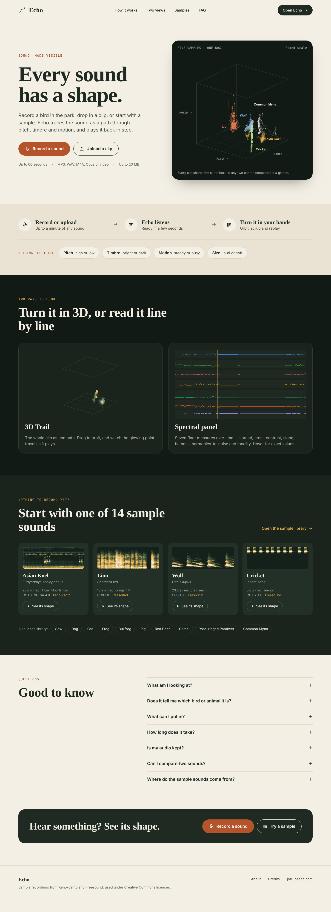
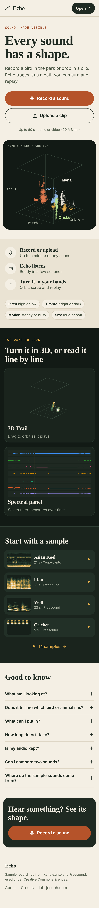
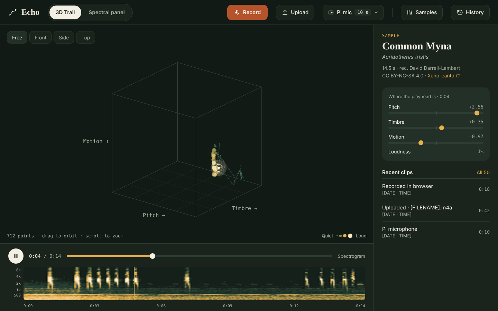
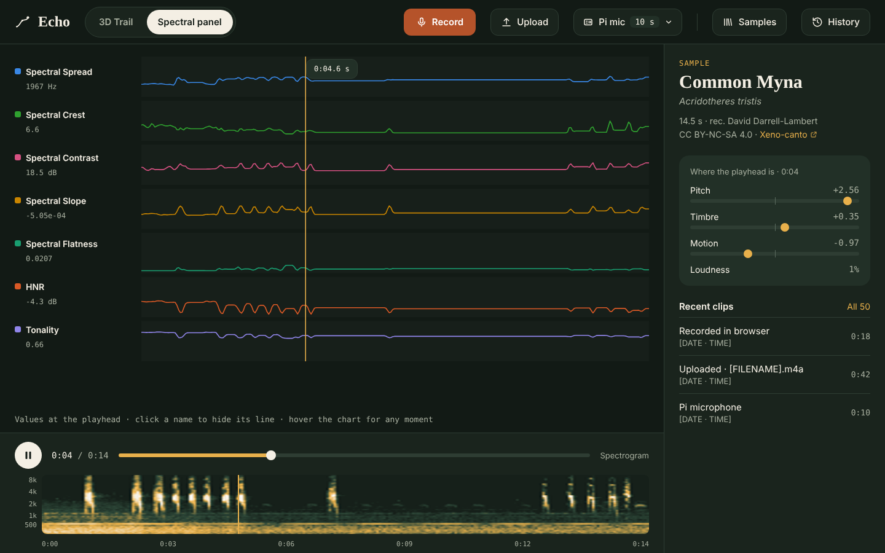
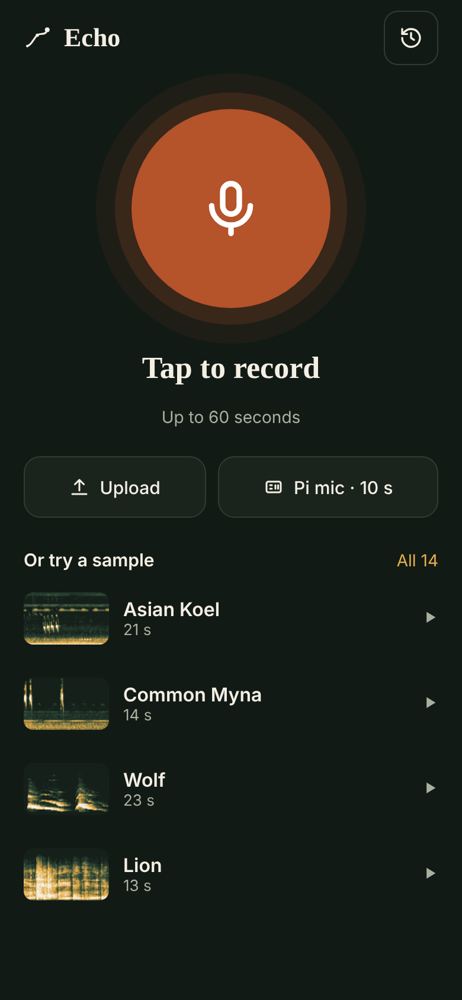
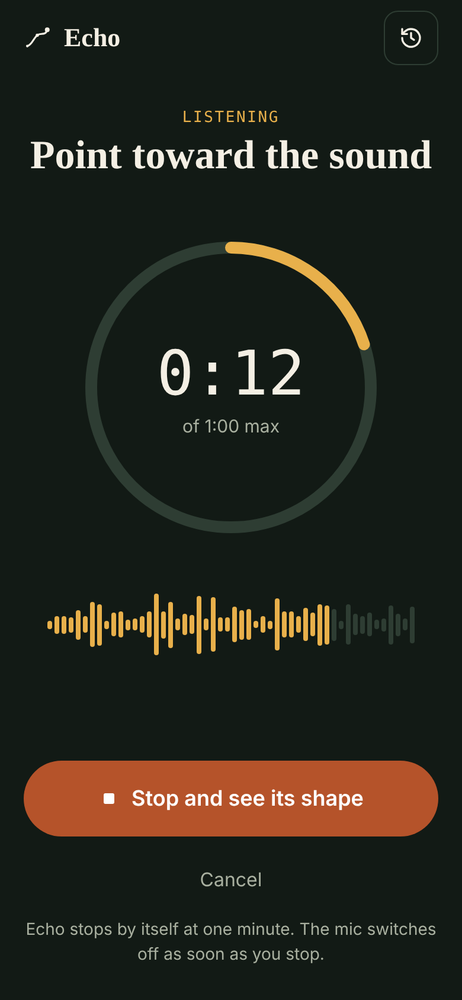
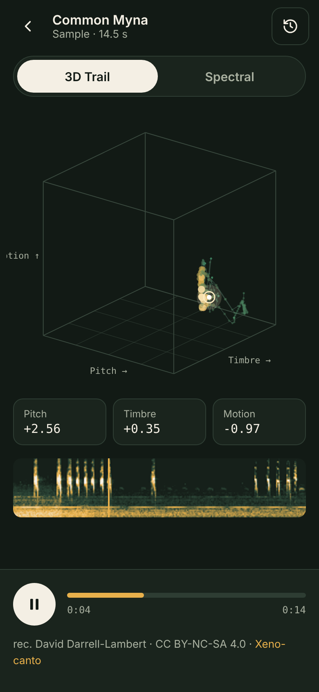

# Echo — Design v2 (frontend redesign brief)

**Status:** ✅ Shipped — all five sessions complete (2026-11-12) (see ROADMAP.md, "v1.6 — Frontend Redesign").
**Design canvas:** https://claude.ai/artifact/LTDnZh1wrRMpBHxwdpmnaH (private to Job — Claude Code can't open it).
**Screenshots:** `docs/design-v2/` — **open the matching PNG before building each screen** and match it. Where a PNG and this text disagree, this text wins; flag the mismatch to Job.
**Scope:** frontend only, plus one small backend route. No changes to extraction, the feature schema, storage, retention or any API response.

This file is the source of truth for the redesign. Build it in the session order
at the bottom, one session per milestone, each one shippable on its own.
CLAUDE.md rules still apply in full (scope, process hygiene, sudo, StaticFiles last).

---

## 1. What changes, in one paragraph

Echo gets a landing page at `/` that explains what it does, and the app moves to
`/app`. The whole frontend gets a new look: a field-notebook feel (warm paper
landing, deep-green night app), a serif display face, amber highlights and a rust
record button. The app keeps every feature it has today (3D Trail, Spectral panel,
spectrogram strip, playback, Samples, History, Pi capture). It gains a clip details
sidebar on desktop and proper phone layouts.

Echo stays source-agnostic: **no bird, species or identification language anywhere**
except the sample library's own names and credits, which already exist.

---

## 2. Routes

| Path | What it shows |
|---|---|
| `/` | Landing page (desktop + phone layouts) |
| `/app` | The app: idle home on phone, workspace on desktop |
| `/app/*` | Reserved for later (e.g. shareable clip links). Serves the app for now |

**Backend.** `StaticFiles(html=True)` mounted at `/` already serves `index.html` for `/`,
but `/app` would 404. Add, **above** the StaticFiles mount and after every API route:

```python
@app.get("/app", include_in_schema=False)
@app.get("/app/{rest:path}", include_in_schema=False)
def spa_app(rest: str = ""):
    return FileResponse(FRONTEND_DIST / "index.html")
```

Guard it with `if FRONTEND_DIST.exists()` like the mount. No existing API path starts
with `/app`, so nothing collides. Add a test in `tests/test_deployment.py` that
`/app` and `/app/anything` return the HTML while `/history` still returns JSON.

**Frontend.** No router library needed: in `main.jsx`, render `<Landing/>` when
`location.pathname` doesn't start with `/app`, else `<App/>`. Landing buttons are
plain links to `/app` (and `/app?record=1` for "Record a sound", which opens the app
with the recorder already started — one tap from landing to recording).

**PWA** (the roadmap's v1.x item, folded in here): `vite-plugin-pwa` manifest with
`start_url: "/app"`, `scope: "/"`, name "Echo", theme colour `#121A15`. The
home-screen icon opens straight into the app and skips the landing page.

---

## 3. Design tokens

Add to `tailwind.config.js` under `theme.extend`. Keep the existing shadcn CSS
variables working by mapping them to these values in `index.css`.

### Colours

| Token | Hex | Use |
|---|---|---|
| `paper` | `#F4EFE4` | Landing background |
| `paper-2` | `#EAE3D3` | Landing alternate band |
| `paper-line` | `#D9D0BD` | Landing dividers, borders |
| `ink` | `#1F2A22` | Landing text, dark buttons |
| `ink-2` | `#45503F` | Landing body text |
| `ink-3` | `#5C6655` | Landing small print |
| `night` | `#121A15` | App background, 3D stage |
| `night-2` | `#1A241D` | App panels, header controls, dock |
| `night-3` | `#223027` | Cards inside panels |
| `night-line` | `#2E3D33` | App borders and dividers |
| `cream` | `#F4EFE4` | App text |
| `muted` | `#A9B0A0` | App secondary text |
| `amber` | `#E8B04B` | Playhead, highlights, links in the app |
| `rust` | `#B5532A` | Record button and primary CTAs (white text on it) |
| `rust-link` | `#9A4522` | Eyebrow labels and link hover on paper |

Contrast was chosen to pass 4.5:1 for body text on its background. Don't lighten
`muted` or `ink-3`, and don't put white text on anything lighter than `rust`.

**Spectral panel line colours stay exactly as they are** in `lib/panelFeatures.js`
(already validated colourblind-safe). The one tweak: Spectral Crest `#008300` →
`#2FA02F` so it reads on `night`. Re-check it against the dataviz validator if
the project has one.

### Type

| Role | Font | Notes |
|---|---|---|
| Display / headings | **Fraunces** (600–700) | Wordmark, H1/H2, card titles, species names |
| Body / UI | **Instrument Sans** (400–600) | Everything else |
| Numbers / labels | **IBM Plex Mono** (400–500) | Timecodes, readouts, eyebrow labels, axis ticks |

Self-host with `@fontsource` packages (`@fontsource-variable/fraunces`,
`@fontsource/instrument-sans`, `@fontsource/ibm-plex-mono`), not Google Fonts.
That keeps the app local-first and working offline once it's installed as a PWA.

Scale (desktop / phone): H1 92/52px · H2 56/30–32px · body 17–21/15–17px ·
small 13–15px. Eyebrow labels: mono, 12–14px, uppercase, 0.12em tracking.

### Shape

Radii: pills and primary buttons `999px`; cards `20–28px`; inner tiles `10–16px`.
Touch targets at least 44px tall. Icons: inline stroke SVG (2px). **No emoji** —
replace the current 🔊 and ☰ button labels with icons + words.

---

## 4. Screens

Eight artboards on the canvas. The v1 landing artboard (bird-ID concept) is
superseded; ignore it.

### 4.1 Landing — desktop (`/`, 1440 wide)



Top to bottom:

1. **Nav** — wordmark (logo + "Echo"), links: How it works · Two views · Samples · FAQ,
   dark pill button "Open Echo →".
2. **Hero** — two columns.
   - Left: eyebrow "Sound, made visible"; H1 "Every sound has a shape."; sub-line;
     buttons **Record a sound** (rust) and **Upload a clip** (outline); limits line
     "Up to 60 seconds · MP3, WAV, M4A, Opus or video · Up to 20 MB".
   - Right: dark card "Five samples · one box" — five sample trails (Asian Koel,
     Lion, Wolf, Cricket, Common Myna) drawn together in one fixed-scale box, each
     in its own colour with a name label. Caption: "Every clip shares the same box,
     so any two can be compared at a glance."
3. **How it works** — one slim `paper-2` band. Three steps in a row with arrows
   between: Record or upload / Up to a minute of any sound → Echo listens / Ready
   in a few seconds → Turn it in your hands / Orbit, scrub and replay. Under a
   divider: label "Reading the trail" + four pills: Pitch high or low · Timbre
   bright or dark · Motion steady or busy · Size loud or soft.
4. **Two views** — `night` band. Heading "Turn it in 3D, or read it line by line".
   Two cards: 3D Trail (Asian Koel trail) and Spectral panel (seven lines,
   Common Myna), each with a one-line description.
5. **Samples** — `night-2` band. "Start with one of 14 sample sounds" + link
   "Open the sample library →". Four cards (Asian Koel, Lion, Wolf, Cricket), each
   with its real spectrogram, name, scientific name, duration, recordist, licence
   and source link, and a "See its shape" button that opens `/app` with that
   sample loaded. Below: chips for the other ten.
6. **FAQ** — two columns: "Good to know" heading on the left; on the right, seven
   `<details>` items, **all closed by default** (copy in §5).
7. **Closing strip** — one dark `ink` rounded bar: "Hear something? See its shape."
   + Record a sound + Try a sample.
8. **Footer** — wordmark, "Sample recordings from Xeno-canto and Freesound, used
   under Creative Commons licences.", links About · Credits · job-joseph.com.

**Hero image:** don't load five feature JSONs on the landing page (≈1.2 MB).
Generate it once from `samples/features/*.json` into a committed static SVG
(e.g. `frontend/src/assets/hero-trails.svg`) with a small script at the repo root
(not under `verification/`, which is gitignored). Same for the two "Two views"
illustrations. Re-run the script if samples are re-extracted by `migrate_schema.py`.

### 4.2 Landing — phone (390 wide)



Same sections, stacked: full-width buttons, the hero box below the copy, steps as
a vertical list, the two views as stacked cards, samples as a list (thumbnail,
name, duration, provider, play icon) with "All 14 samples →", the same FAQ
(closed), the closing strip, footer.

### 4.3 App — desktop, 3D Trail (`/app`, 1440×900)



- **Header (72px):** wordmark (links to `/`) · segmented tabs **3D Trail /
  Spectral panel** · spacer · **Record** (rust) · **Upload** · **Pi mic** with a
  duration chip ("10 s ▾") · divider · **Samples** · **History**.
- **Stage:** `night` background, the existing R3F scene restyled (see §6 on trail
  colour). Top-left camera presets **Free / Front / Side / Top** (the open roadmap
  item — build only if cheap; otherwise leave them out). Bottom-left mono caption
  "1,028 points · drag to orbit · scroll to zoom". Bottom-right loudness legend
  (Quiet → Loud, four dots growing).
- **Dock (≈196px, `night-2`):** play/pause (cream circle), time "0:04 / 0:14",
  amber progress bar, then the spectrogram strip with Hz ticks on the left
  (500 … 8k from `freq_ticks`; drop any tick closer than ~14px to its neighbour), amber playhead line, time ticks underneath.
- **Sidebar (360px, `night-2`):**
  - *Clip card* — for a sample: "SAMPLE" eyebrow, name (Fraunces), scientific
    name, duration, recordist, licence, source link (this replaces today's
    floating attribution chip). For a history clip: source type ("Recorded in
    browser", "Uploaded · filename", "Pi microphone"), duration, date.
  - *At the playhead* — Pitch, Timbre, Motion as small −3…+3 sliders (read-only)
    with mono values, plus Loudness %.
  - *Recent clips* — the latest three from `/history`, "All N" (at most 20, this browser's own) opens the History sheet.

### 4.3a Added after launch (2026-11-13)

- **Pi mic recording (owner only).** Same screen as browser recording (§4.6):
  amber "LISTENING" label, heading "Pi mic is listening", the countdown ring
  ("0:02 of 0:10"), a rust "Stop and see its shape" button and a text "Cancel".
  No level bars (the sound is on the Pi); one line says "Recording on the Pi,
  not on this phone." After the recording time the ring is full and it reads
  "Analysing"; only Cancel remains. On desktop the header shows one row:
  a tile "Pi mic is listening 0:02 / 0:05" with a progress bar, then Stop and
  Cancel; Record and Upload are hidden while it runs so the header never wraps.
- **History, selecting several.** "Select" in the sheet header (amber text
  button, becomes "Done"); a long press on a row does the same on touch. Rows
  become labels with real checkboxes (20px, amber accent, 44px row height);
  ticked rows get the amber ring. Above the list: "Select all" (shows the mixed
  state), "N selected", and "Delete N clips", which turns red and asks "Delete
  N clips for good?" with "Keep" beside it. Escape leaves selection first. The
  per-row bin stays in the normal list.

### 4.4 App — desktop, Spectral panel



Same header, dock and sidebar. The stage shows the seven lanes stacked. On the left
is a 206px label column: colour square, name (a toggle button with `aria-pressed`),
and the value at the playhead in mono. The amber playhead runs through all lanes
with a time tag. Caption: "Values at the playhead · click a name to hide its line ·
hover the chart for any moment".

### 4.5 Phone — app home (`/app`, idle)



Wordmark + History button. A large rust **record** circle (168px) with soft rings,
"Tap to record", "Up to 60 seconds". Below it, two buttons: **Upload** and **Pi mic · 10 s**.
"Or try a sample" list (thumbnail, name, duration) with "All 14".

### 4.6 Phone — recording



"LISTENING" eyebrow, "Point toward the sound", a 280px countdown ring (amber arc,
"0:12 of 1:00 max"), live level bars, big rust **Stop and see its shape**, Cancel,
and a note: "Echo stops by itself at one minute. The mic switches off as soon as
you stop." The ring and level bars use the existing `useRecorder` state;
level comes from an `AnalyserNode` on the same stream.

### 4.7 Phone — result



Back button, clip name and type. Tabs Trail / Spectral. Trail fills about 360px.
Three readout chips (Pitch, Timbre, Motion at the playhead), the spectrogram strip
with playhead, a bottom dock with play/pause and progress, and the attribution line
for samples.

---

## 5. Copy (final — don't rewrite)

> **Copy change (Job, 2026-11-12):** no bird language in the landing copy. The
> two hero sub-lines and FAQ question 2 below were reworded in S4; they
> previously read "Record a bird in the park…" and "Does it tell me which bird
> or animal it is?". Sample names and credits are the only exception (D2).

**Hero sub-line (desktop):** Record a sound in the park, drop in a clip, or start
with a sample. Echo traces the sound as a path through pitch, timbre and motion,
and plays it back in step.

**Hero sub-line (phone):** Record a sound in the park or drop in a clip. Echo
traces it as a path you can turn and replay.

**Two views:** 3D Trail — "The whole clip as one path. Drag to orbit, and watch
the glowing point travel as it plays." Spectral panel — "Seven finer measures over
time — spread, crest, contrast, slope, flatness, harmonics-to-noise and tonality.
Hover for exact values."

**FAQ (all closed by default):**

1. **What am I looking at?** Each point is one moment of sound, about fifty every
   second. Where it sits shows its pitch (high or low), timbre (bright or dark) and
   motion (steady or busy). Bigger, brighter points are louder.
2. **Does it tell me what made the sound?** No. Echo shows the shape of any
   sound, whatever made it. It doesn’t try to name the source.
3. **What can I put in?** Record up to 60 seconds in your browser, or upload MP3,
   WAV, M4A, Opus, or a video file, up to 20 MB.
4. **How long does it take?** A few seconds for most clips. Even a full minute is
   ready in under 15 seconds.
5. **Is my audio kept?** Only a small copy for playback, and only this browser
   can see it. The original file is discarded after analysis, and clips you
   haven’t opened in 30 days are deleted.
6. **Can I compare two sounds?** Yes, by eye. Every clip is drawn in the same fixed
   box, so a high note sits high in every one of them.
7. **Where do the sample sounds come from?** Xeno-canto and Freesound, used under
   Creative Commons licences. Each sample shows its recordist and licence.

The footer's **Privacy** dialog repeats answer 5 word for word, then adds: there
are no accounts; one cookie holds a random ID so your clips are yours alone; the
browser microphone is used only while recording.

If any limit in this copy changes (60 s, 20 MB, the 30-day rule, speed), update
the copy in the same change. History keeps each browser's newest 20 clips
(`docs/LAUNCH.md`, decision L6); the History sheet says "Your clips live in this
browser only."

---

## 6. Decisions

| # | Decision | Status |
|---|---|---|
| D1 | Landing at `/`, app at `/app`, PWA starts at `/app` | ✅ Decided (Job) |
| D2 | No bird/species/ID language; no future-project teasers on the site. Reaffirmed 2026-11-12: this includes the §5 landing copy | ✅ Decided (Job) |
| D3 | Self-hosted fonts via `@fontsource` | ✅ Proposed in this brief |
| D4 | **3D trail colour.** Green → amber → pale-cream by loudness, on `night`, replacing the teal additive-glow trail. | ✅ Decided (Job, 2026-11-12) — built in S2 |
| D5 | Spectrogram colour ramp: `#16201A` → `#2F4A3A` (35%) → `#E8B04B` (70%) → `#F4EFE4`, replacing the current ramp | ✅ Decided (Job, 2026-11-12) — built in S2 |
| D6 | Camera presets (Free/Front/Side/Top) | ⏸ Left out for now (Job, 2026-11-12) — not built in S2 |

---

## 7. Build order (one session each)

1. **Routing + PWA.** Backend `/app` route + test; `main.jsx` path switch with a
   placeholder landing; `?record=1` handling; vite-plugin-pwa with `start_url: /app`.
   *Done when:* `/` shows the placeholder, `/app` shows today's app, both work
   behind the tunnel, and the PWA installs on Android and opens at `/app`.
2. **Tokens + desktop app reskin.** Tailwind tokens, fonts, header, sidebar
   (clip card, playhead readout, recent clips), dock with the spectrogram strip,
   Spectral panel label column. Apply D4/D5 as Job decides.
   *Done when:* both desktop views match §4.3–4.4, with every existing feature
   still working.
3. **Phone app.** App home, recording screen (ring + level bars), result screen.
   *Done when:* tested on Job's Android phone in Chrome, recording end to end.
4. **Landing page.** Desktop + phone, hero SVG script, sample cards that deep-link
   into `/app` with the sample loaded, FAQ with `<details>`.
   *Done when:* it matches §4.1–4.2, Lighthouse accessibility ≥ 95, and the page
   weighs < 300 KB without fonts.
5. **Tests + docs.** Update the Vitest tests and Playwright e2e specs whose
   selectors depend on old labels (e.g. "🔊 Samples", "☰ History", drawer
   structure); add e2e for `/` → `/app` and the FAQ. Log in
   `VERIFICATION_LOG.md`, learnings in `LEARNINGS.md`, statuses in `ROADMAP.md`.

**Not in scope:** any change to `extraction.py`, feature JSON, `FEATURE_SCHEMA_VERSION`,
the DB schema, retention, upload limits or `/capture` behaviour. If a session finds
it needs one, stop and ask Job.

---

## 8. Notes on the screenshots

- They are mockups drawn from **real sample data** (Common Myna, Asian Koel, Lion, Wolf, Cricket), so trails, lanes and spectrograms look like the real thing.
- The 3D trail in them is a flat SVG projection. Build it with the existing R3F scene, not as an image. Only the landing-page illustrations are static SVGs (§4.1).
- History rows show placeholders (`[DATE · TIME]`, `[FILENAME]`). Fill them from `/history`.
- The phone screens are 390×844, rendered at 2×.
